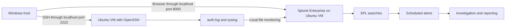

# Mini SOC Lab with Splunk

A practical security monitoring lab built with Ubuntu Server and Splunk Enterprise. I collected local authentication and system logs, wrote SPL searches, configured four scheduled alerts, and documented three investigations of controlled test activity.

The project demonstrates an introductory SIEM workflow: collect logs, search for relevant events, trigger alerts, investigate context, and record a conclusion. These were lab exercises; the findings do not represent confirmed attacks or production incident response.

## What I built

| Component | Implementation |
| --- | --- |
| Virtual machine | Ubuntu Server, 4 GB RAM, 2 virtual CPUs, 40 GB disk |
| Virtualization | Oracle VirtualBox on a Windows host |
| SIEM | Splunk Enterprise running on the same Ubuntu VM |
| Log sources | `/var/log/auth.log` and `/var/log/syslog` |
| Searches | SPL searches for SSH, local accounts, sudo commands, and services |
| Alerts | Failed SSH logins, successful password SSH login, new local user, selected sudo commands |
| Investigations | Three reports explaining the test, evidence, interpretation, and outcome |

## Lab architecture

VirtualBox uses NAT with host forwarding bound to `127.0.0.1`. Splunk reads local files directly; this lab does not use a Universal Forwarder or a separate indexer.

## Detections

| Detection | Search | Lab trigger | Lab severity |
| --- | --- | --- | --- |
| Multiple failed SSH logins | [Failed SSH](queries/01-failed-ssh.spl) | More than 1 returned event in 15 minutes | High |
| Successful password SSH login | [Successful SSH](queries/02-successful-ssh.spl) | More than 0 returned events | Low |
| New local user | [Account creation](queries/03-new-local-user.spl) | More than 0 returned events | High |
| Selected administrative commands | [Sudo activity](queries/04-administrative-commands.spl) | More than 0 returned events | Medium |

These severities are exercise settings, not assessments of confirmed malicious activity. The failed-login rule uses a global event count, not a per-user or per-IP brute-force model. See [alert configuration and limitations](docs/detections.md).

## Investigation reports

- [INC-001 — Failed SSH login test](incidents/INC-001-failed-ssh.md)
- [INC-002 — Local user creation test](incidents/INC-002-new-user.md)
- [INC-003 — Administrative command test](incidents/INC-003-sudo.md)

Identifiers in these reports are anonymized. No raw log export is included.

## Screenshots

Three selected original lab screenshots show [localhost port forwarding](screenshots/01-localhost-forwarding.png), [failed-login alert settings](screenshots/02-failed-ssh-alert.png), and [new-user alert settings](screenshots/03-new-user-alert.png). See the [screenshot notes](screenshots/README.md) for configuration details and evidence limitations.

## Documentation

- [Lab setup and collection](docs/lab-setup.md)
- [Detections, tuning, and known limitations](docs/detections.md)
- [Validation and reproduction checklist](docs/validation.md)

## What I learned

I practiced Linux log collection, SPL filtering, scheduled alert configuration, and evidence-based investigation. Troubleshooting included granting the Splunk service account access to logs and recognizing that repeated syslog messages can change event counts. I also learned to distinguish an alert from an incident: a successful login or a sudo command needs context before it can be classified as suspicious.

## Next improvements

- Add field extraction and group failed-login counts by source address, user, and destination host.
- Test both positive and negative cases with documented expected results.
- Review overlapping search windows and suppression so unrelated activity is not hidden.
- Add successful public-key SSH authentication coverage.
- Create synthetic sample data and validate it separately from the original lab evidence.

The source project records successful lab tests. The packaged queries have not been rerun in a live Splunk instance as part of preparing this repository. This repository contains documentation and search files, not an automatically deployable Splunk app.

