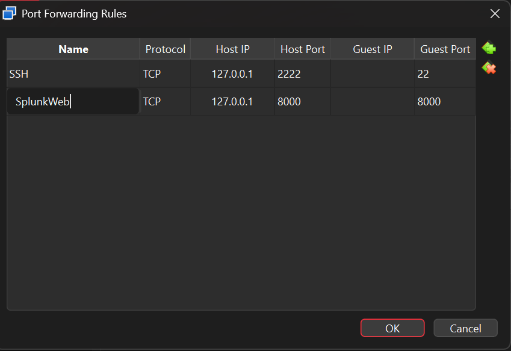
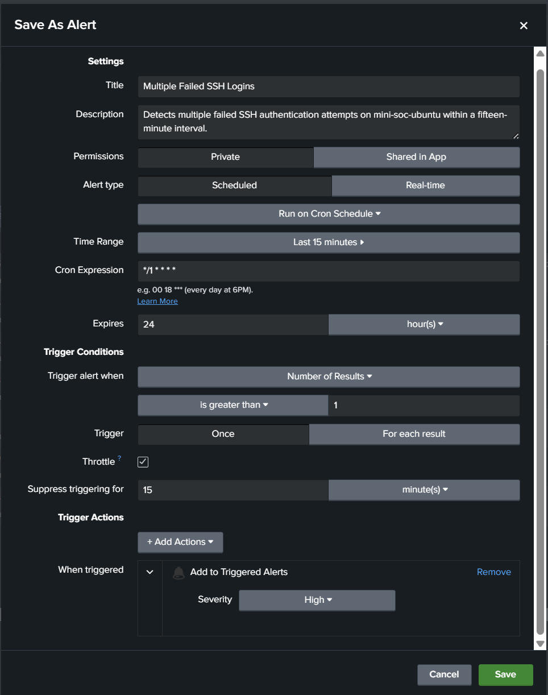
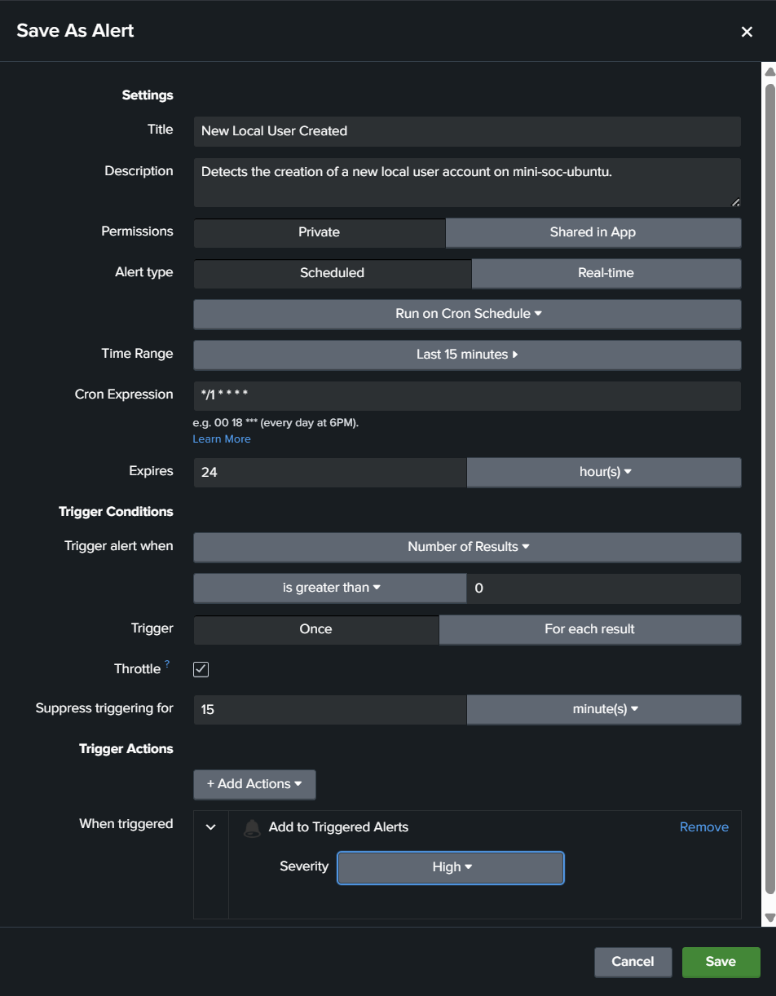

# Selected lab screenshots

These images were extracted from the original Word project and visually inspected. They are unmodified source screenshots, not recreated evidence.

| File | Original figure | What it shows | Review notes |
| --- | --- | --- | --- |
| `01-localhost-forwarding.png` | Figure 7 | SSH and Splunk Web forwarding bound to loopback | Shows only generic local ports and `127.0.0.1` |
| `02-failed-ssh-alert.png` | Figure 23 | Failed-login threshold, schedule, severity, and suppression | Retains the generic original lab hostname; save dialog is configuration evidence |
| `03-new-user-alert.png` | Figure 28 | New-user alert configuration | Retains the generic original lab hostname; save dialog does not prove persisted settings |

## Localhost forwarding

## Failed SSH alert configuration

## New local user alert configuration

Raw-event screenshots were excluded because some contain personal usernames, home paths, and precise timestamps. The successful-login configuration screenshot was excluded from this selection because its suppression unit differs from the narrative. A triggered-alert screenshot can be added after the test chronology is clarified and publication is approved.

